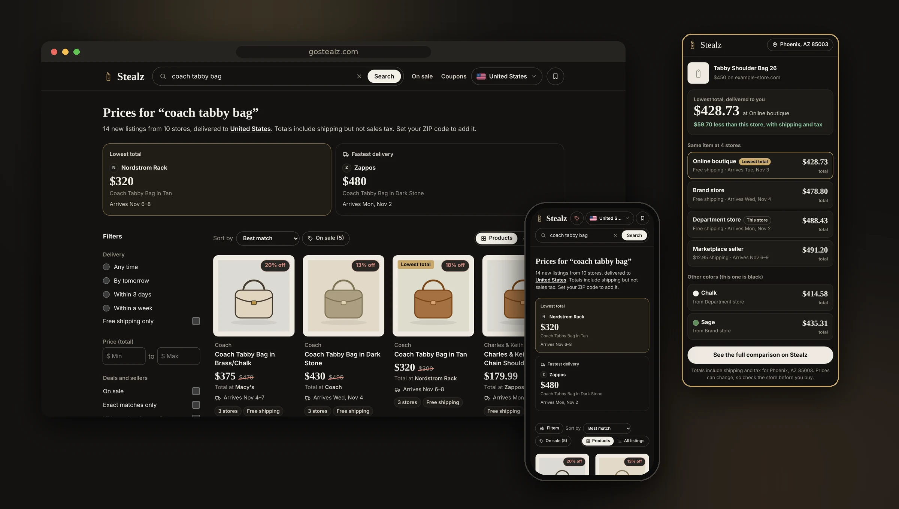
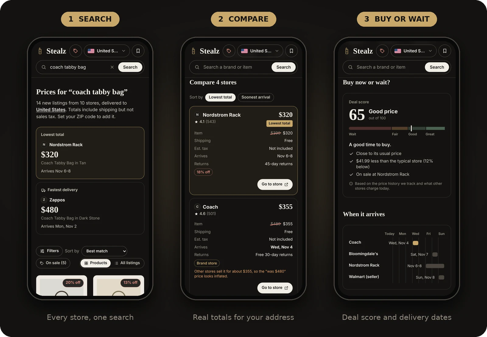
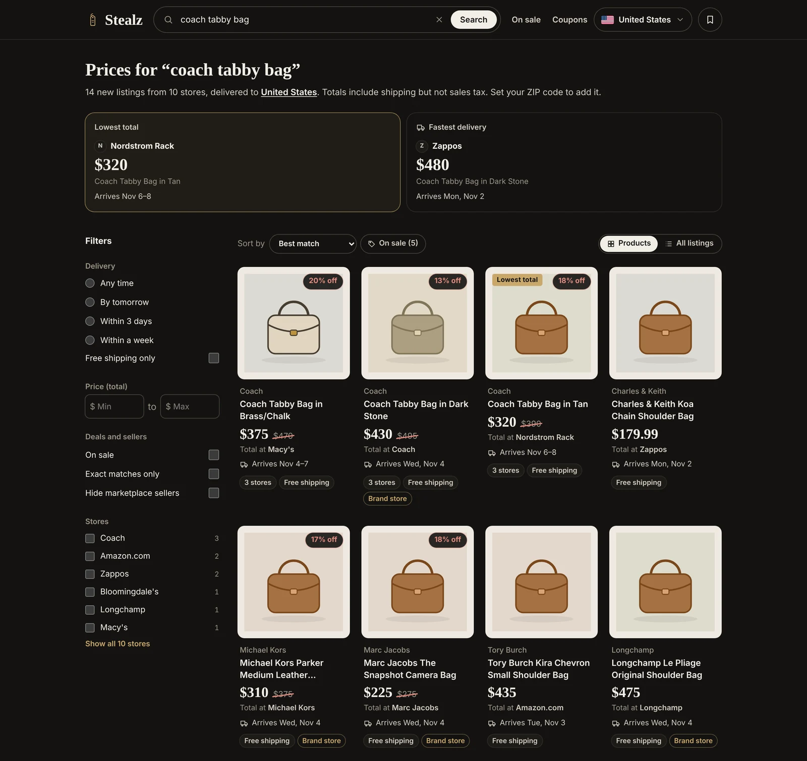
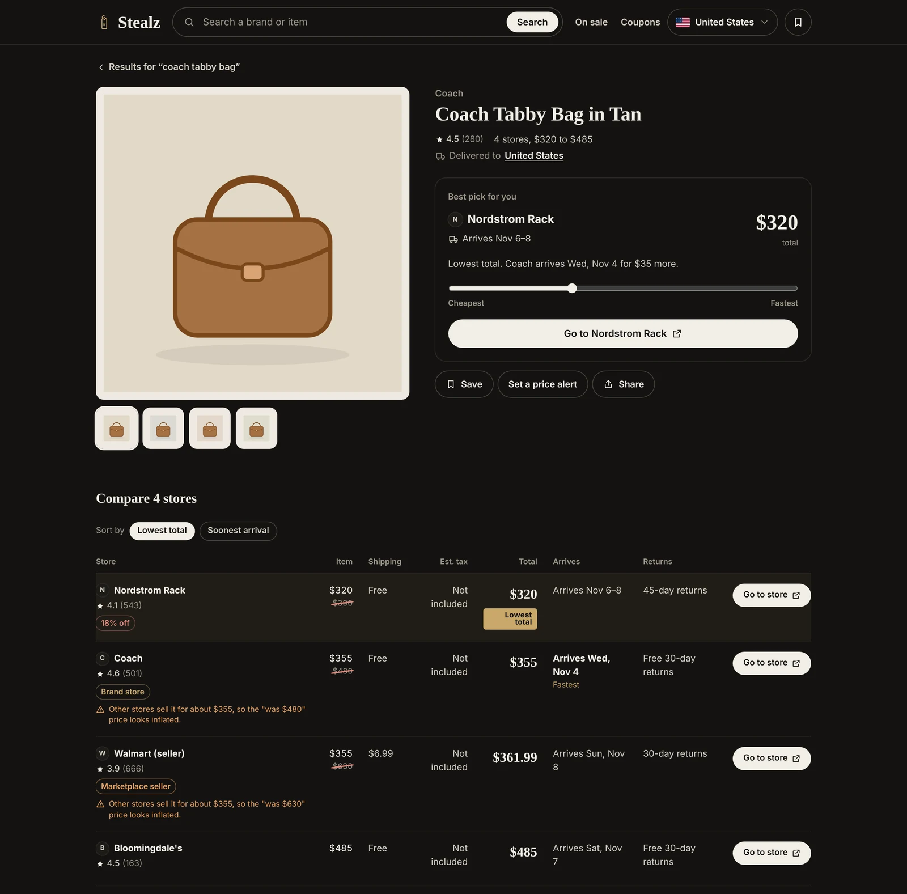
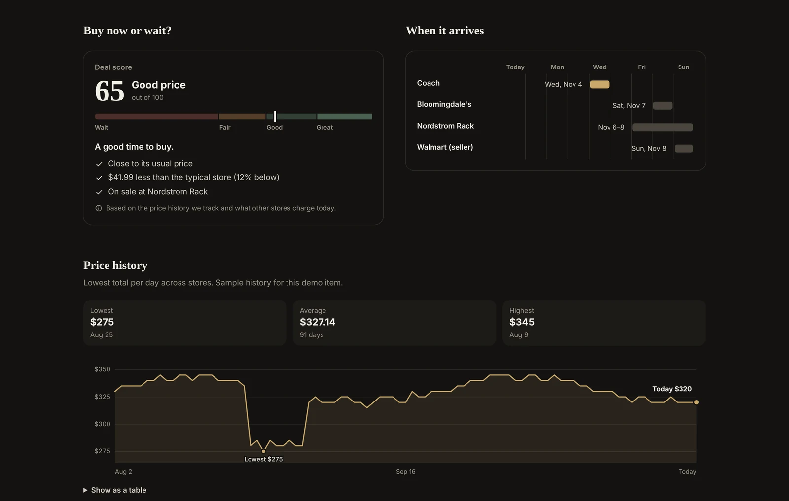
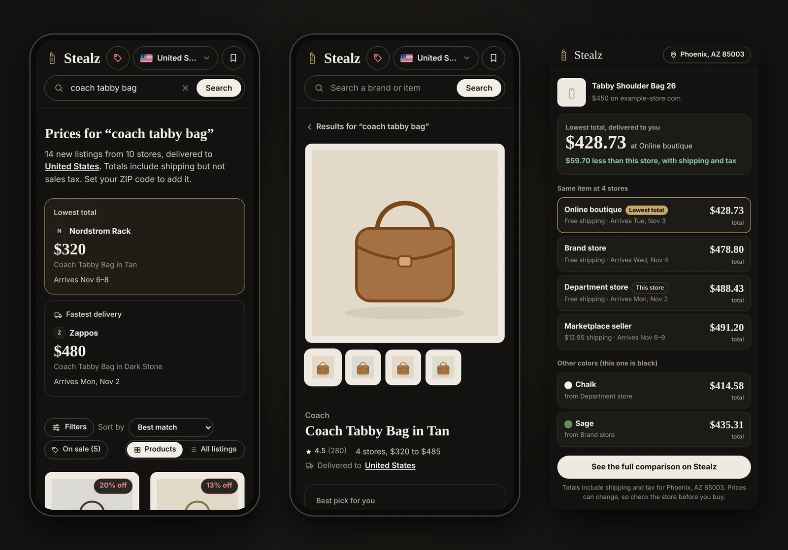
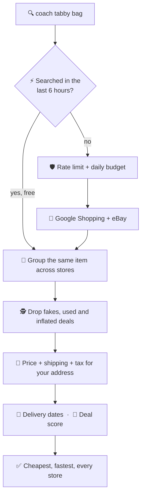
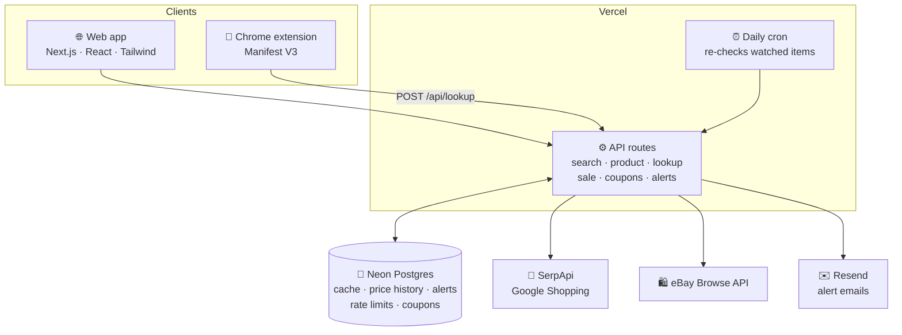

<div align="center">


# 🏷️ Stealz

### Stop paying the sticker price. Find the real steal.

**Compare bags, shoes, clothing and accessories across every store by what you'd _actually_ pay<br/>(price + shipping + tax for your address) and the day it reaches your door.**

<br/>

[](https://www.gostealz.com)

[](https://www.gostealz.com/extension)


[](https://github.com/Aadharsh21/Stealz/actions/workflows/ci.yml)


<br/>



<sub>Screenshots use the site's built-in sample data. On <a href="https://www.gostealz.com">gostealz.com</a> the prices are live.</sub>

</div>

---

## 😩 The problem

The cheapest-looking store usually isn't the cheapest. With 8.6% sales tax, a **$450** bag plus $15 shipping comes to
**$503.70**, while the same bag listed at **$460** with free shipping comes to **$499.56**. Shopping sites sort by
sticker price, so you only find that out at checkout, one store at a time.

And the "deals" aren't always deals: a "was $480" tag on a bag every other store sells for $355, a copy shop listed
next to the real brand, or a cheaper result that turns out to be a different color.

**Stealz sorts by the real total, for your address, and filters out the junk.**

## 🗺️ How you use it

<div align="center">

</div>

## 🧾 Real catches, not a mockup

These came up while testing on live Google Shopping results, and each one is now handled automatically.

| 🔍 Search | 😬 What showed up | ✅ What Stealz does now |
| --- | --- | --- |
| Coach Willow bag, Dubai | A shop selling **"master copy"** bags, and a listing far below anything Coach charges | Hides copy shops ("master copy", "first copy", "replica", "dupe", "1:1", "mirror quality") and luxury items priced under the brand's floor. The search showed **25 listings, "2 likely fake" hidden** |
| Swarovski Millenia necklace | The "lowest total" was a **different necklace**, a Maira pendant for AED 96 | Matches on model names like "Millenia" before everyday words like "necklace" or "pink" |
| Coach bag that usually costs $495, in the extension | An odd print-shop website asking **$1,242** | Leaves listings at more than twice the item's usual total out of extension lookups |
| Coach bag, in the extension | Coach listed twice, as "coach.com" and "COACH" | Recognizes one store under both names |

## ✨ What it does

<table>
<tr>
<td width="33%" valign="top">

### 🔍 Compare

*"coach tabby bag"*

One search pulls the item from **every store Google Shopping knows**, then prices each one with **shipping and tax for
your ZIP code, postcode, PIN code or emirate**.

</td>
<td width="33%" valign="top">

### 🎯 Decide

*"Is $320 actually a good price?"*

A **deal score from 0 to 100** checks today's price against other stores and the item's history. Not yet? Set a
target and get an **email when it drops**.

</td>
<td width="33%" valign="top">

### 🧩 Shop anywhere

*Already on a store's page?*

Click the **Chrome extension** and see the same item at every other store, **cheapest first**, how much you'd save,
and **other colors**.

</td>
</tr>
</table>

## 🧰 Features

| | |
| --- | --- |
| 🧾 **Real totals** | Item price + shipping + tax for your address. Free-shipping thresholds applied when your order qualifies. |
| 🚚 **Delivery dates** | "Arrives Nov 3–5" worked out for your location from each store's estimate. No estimate? It says so instead of guessing. |
| 📍 **Knows where you are** | Location detected automatically, or type a ZIP code, postcode, PIN code or pick your emirate. |
| 🎯 **Deal score** | 0 to 100 with a plain verdict: buy now or wait. 80+ is a great deal. |
| 🚩 **Fake discount check** | Flags "was" prices that no other store actually charges. |
| 🕵️ **Originals only** | Copy shops, fake-looking listings, used, refurbished, resale and rentals are hidden, and it tells you how many. |
| 🎨 **Color check** | Calls out when a cheaper listing is actually a different color. |
| 🏪 **Seller signals** | Brand stores, marketplace sellers, store ratings and return policies, so a sketchy cheap listing doesn't win by default. |
| 📉 **Price history** | A chart of the lowest total per day, with the lowest, average and highest prices. |
| 🔔 **Price-drop alerts** | Email when it drops below your target. No account, one-click confirm and unsubscribe. |
| 🏷️ **On sale** | Real markdowns on designer clothes, bags and sneakers, by category, per country. |
| 🎟️ **Coupons and offers** | Promo codes stores publish, which stores have sales on, and more stores to check. |
| 🛍️ **More stores** | One-tap links to search the same item on stores Google doesn't list, like Trendyol in the UAE or Selfridges in the UK. |
| ⭐ **Watchlist and sharing** | Save items on your device and share a comparison with a link. |
| 📱 **Built for phones** | Every page works on a small screen, from search to the price chart. |

## 📸 A closer look

<details open>
<summary><b>🔍 Search results:</b> lowest total and fastest delivery up top, filters for delivery, price and seller type</summary>
<br/>

</details>

<details>
<summary><b>⚖️ Product page:</b> the best pick for you, and every store side by side</summary>
<br/>

</details>

<details>
<summary><b>📈 Buy now or wait:</b> deal score, delivery timeline and price history</summary>
<br/>

</details>

<details>
<summary><b>🧩 Phone and extension</b></summary>
<br/>

</details>

## 🌍 Countries

| | Country | Currency | Tax | Your location |
| :-: | --- | :-: | --- | --- |
| 🇺🇸 | United States | USD | Sales tax **added** for your state, with clothing exemptions (PA, NJ, MN, VT, and partial in NY, MA, RI) | ZIP code |
| 🇬🇧 | United Kingdom | GBP | VAT already included | Postcode |
| 🇦🇪 | United Arab Emirates | AED | VAT already included | Emirate |
| 🇮🇳 | India | INR | GST already included | PIN code |

## 🔄 How it works



<details>
<summary><b>🏗️ System architecture</b></summary>
<br/>



</details>

## 🧩 Get the extension

1. Download it from **[gostealz.com/extension](https://www.gostealz.com/extension)** and unzip it
2. Open `chrome://extensions` and turn on **Developer mode**
3. Click **Load unpacked** and pick the `stealz-extension` folder
4. On any store's product page, click the 🏷️ Stealz icon

## 🛡️ What it will never do

> ❌ Make you sign up &nbsp;·&nbsp; ❌ Read a page you didn't click the extension on &nbsp;·&nbsp; ❌ Send the page you're
> on (only the store's address leaves your browser) &nbsp;·&nbsp; ❌ Guess a delivery date a store didn't give &nbsp;·&nbsp;
> ❌ Keep eBay seller usernames
>
> **You always buy from the store itself.** Stealz just tells you which one, and reminds you to confirm the price there
> before you pay.

## 💸 Runs on free plans

Live prices cost money per search, so a public site has to protect itself. Apart from the domain (about $11 a year),
everything runs on free plans:

- ⚡ **6-hour shared cache** so popular searches cost nothing after the first person runs them
- 🚦 **Per-visitor rate limits** on anything that makes a paid call
- 🧮 **Daily and monthly budgets** (40 a day, 240 a month) so it can never go over SerpApi's 250 free searches
- ✉️ **Owner emails** at 80% and 100% of the month, when the daily cap is hit, and when the SerpApi plan runs low
- ⏰ **A daily cron** that re-checks only items people are watching

## 🔧 Under the hood

```text
stealz/
├── app/                 pages + API routes (search, product, lookup, sale, coupons, alerts, cron)
├── components/          offer table, deal score, delivery timeline, price history, filters...
├── lib/                 the engine
│   ├── providers/       SerpApi, eBay and sample-data sources
│   ├── normalize.ts     groups the same item across stores, flags fake shops
│   ├── tax.ts           US sales tax by state, clothing exemptions
│   ├── delivery.ts      turns "Arrives Nov 3–5" into dates
│   ├── deal.ts          deal score, inflated discounts, color checks
│   ├── limits.ts        rate limits and the live-search budget
│   └── cache.ts  db.ts  Postgres cache; tables created on first run
├── extension/           Chrome extension: popup + a page reader that runs only on click
├── tests/               40 tests: pricing, tax, delivery, trust filters, deals, UK, extension lookups
└── scripts/             packages the extension download
```

- **Stack.** Next.js 16 (App Router), React 19, TypeScript and Tailwind CSS 4 on Vercel, with Neon serverless
  Postgres, SerpApi, the eBay Browse API and Resend.
- **No migrations.** The database schema creates itself the first time the app talks to an empty database.
- **Works with zero setup.** No API keys? It runs on built-in sample data so every page still works.
- **Checked on every push.** GitHub Actions runs the type check, all tests and a production build, and checks that
  the extension download matches the code in `extension/`.

### 🚀 Run it locally

```bash
git clone https://github.com/Aadharsh21/Stealz.git
cd Stealz
npm install
npm run dev        # http://localhost:3000, sample data until you add keys
npm test           # 40 tests
```

<details>
<summary><b>☁️ Deploy your own with live prices, history and alerts</b></summary>

### 1. Live prices

1. Create a free account at [serpapi.com](https://serpapi.com) (250 searches a month).
2. In Vercel, add `SERPAPI_API_KEY` under **Project → Settings → Environment Variables**, then redeploy.

A search uses one credit and opening a product's comparison uses one more. Raise `DAILY_LIVE_SEARCHES` and
`MONTHLY_LIVE_SEARCHES` if you upgrade the plan.

### 2. Price history and alerts

1. **Database:** Vercel **Storage → Create → Neon (Postgres)**, connected to the project. This adds `DATABASE_URL`.
2. **Email:** a [Resend](https://resend.com) account with a verified domain. Add `RESEND_API_KEY` and `EMAIL_FROM`.
3. **Daily price check:** add `CRON_SECRET` (any long random string). Vercel calls `/api/cron/check-prices` daily.
4. Set `APP_URL` to your site so email links point to the right place.

### Environment variables

| Variable | Needed for | Notes |
| --- | --- | --- |
| `SERPAPI_API_KEY` | Live prices | Without it the site shows sample data |
| `DATABASE_URL` | History, alerts, shared cache | Neon via Vercel Storage works |
| `RESEND_API_KEY`, `EMAIL_FROM` | Alert emails | |
| `CRON_SECRET` | Daily price checks | |
| `APP_URL` | Email links | Falls back to the Vercel production URL |
| `OWNER_EMAIL` | Usage warnings | Emails you before searches run out |
| `EBAY_CLIENT_ID`, `EBAY_CLIENT_SECRET` | Optional | Adds new eBay listings in the US |

See [`.env.example`](.env.example) for every option. After changing anything in `extension/`, run
`./scripts/package-extension.sh` to rebuild the download.

</details>

## ⚠️ Honest limits

- **40 live lookups a day** (a search or opening a product's comparison each use one). Once the cap is hit, searches
  people already ran still show results, but brand-new ones wait until the next day.
- **Only stores Google Shopping lists**, plus new eBay listings in the US. "Search more stores" links cover some of
  the rest.
- **US sales tax is an estimate** from Google or your state's average rate, so your exact city rate can differ a little.
- **No automatic check catches every fake.** A copy shop with a normal name and a realistic price can still slip
  through.
- **Delivery dates are the stores' own estimates**, and prices can change after they're checked.
- **Price history fills in over time**, from daily checks of items people are watching.
- **The extension isn't on the Chrome Web Store yet**, so it's installed with Load unpacked.
- Four countries for now: the US, UK, UAE and India.

## 👤 Built by

Designed and built in two days by **[Aadharsh Arunn](https://github.com/Aadharsh21)**, a Computer Systems Engineering
student at Arizona State University.

**Credits:** prices come from Google Shopping through [SerpApi](https://serpapi.com) and from the eBay Browse API. US
tax rates are from the Tax Foundation. Stealz isn't affiliated with any store it lists.

## 📄 License

MIT. See [LICENSE](LICENSE).

---

<div align="center">

**🏷️ Find your next steal at [gostealz.com →](https://www.gostealz.com)**

</div>
