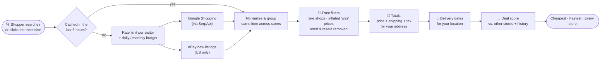
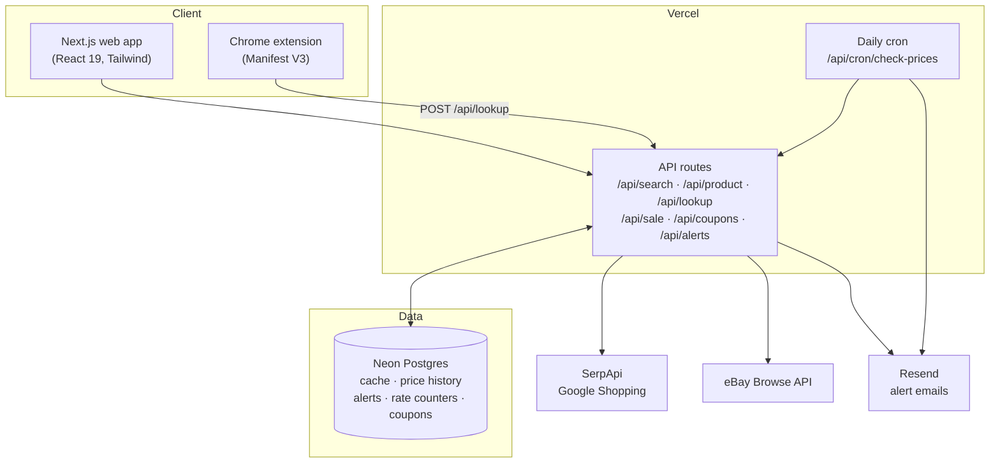

<div align="center">


# Stealz

### Find the real steal.

**Compare bags, shoes, clothing and accessories across every store, by what you'd _actually_ pay<br/>(price + shipping + tax for your address) and the day it reaches your door.**

[](https://www.gostealz.com)
[](https://www.gostealz.com/extension)

[](https://github.com/Aadharsh21/Stealz/actions/workflows/ci.yml)


<br/>


<sub>🇺🇸 United States &nbsp;·&nbsp; 🇬🇧 United Kingdom &nbsp;·&nbsp; 🇦🇪 United Arab Emirates &nbsp;·&nbsp; 🇮🇳 India</sub>

</div>

<br/>

## 💡 The problem

The price on the tag is rarely what you pay. With 8.6% sales tax, a **$450** bag plus $15 shipping comes to **$503.70**, while the same bag listed at **$460** with free shipping comes to **$499.56**. Shopping sites sort by sticker price, so the cheapest-looking store often isn't the cheapest.

**Stealz sorts by the real total.** Search once, and every store is priced for _your_ address, with the date it would actually arrive.

<br/>

## ✨ What it does

<table>
<tr>
<td width="33%" valign="top">

### 🧾 Real totals
Item price **+ shipping + tax** for your ZIP code, postcode, PIN code or emirate. Free-shipping thresholds applied when you qualify.

</td>
<td width="33%" valign="top">

### 🚚 Delivery dates
"Arrives Nov 3–5" worked out for your location from each store's estimate, so you can pick fastest or cheapest.

</td>
<td width="33%" valign="top">

### 🎯 Deal score
0 to 100: is today's price good, or should you wait? Based on what other stores charge and the item's price history.

</td>
</tr>
<tr>
<td valign="top">

### 🚩 Fake-deal detection
Flags inflated "was" prices, too-good-to-be-true listings, copy shops and fake-looking luxury bags. New items only.

</td>
<td valign="top">

### 🔔 Price-drop alerts
Set a target price and get an email when it drops. No account needed, one-click confirm and unsubscribe.

</td>
<td valign="top">

### 🧩 Chrome extension
On any store's product page, one click shows the same item at every other store, cheapest first, plus other colors.

</td>
</tr>
</table>

Also: **On sale** and **Coupons** pages, a saved watchlist, shareable comparison links, one-tap links to search more stores in each country, and a sample-data mode so it runs with zero setup.

<br/>

## 📸 A closer look

<details open>
<summary><b>Search results:</b> lowest total and fastest delivery up top, filters for delivery, price and seller type</summary>
<br/>

</details>

<details open>
<summary><b>Product page:</b> the best pick for you, and every store side by side with item, shipping, tax, total, arrival and returns</summary>
<br/>

</details>

<details open>
<summary><b>Buy now or wait:</b> deal score, a delivery timeline and price history</summary>
<br/>

</details>

<details open>
<summary><b>Phone and extension:</b> built mobile-first, and the extension popup on a store page</summary>
<br/>

</details>

<br/>

## 🌍 Countries

Each country has its own currency, tax rules and way of finding your location.

| | Country | Currency | Tax | Your location |
| :-: | --- | :-: | --- | --- |
| 🇺🇸 | United States | USD | Sales tax **added** by ZIP code, with clothing exemptions (PA, NJ, MN, VT, and partial in NY, MA, RI) | ZIP code |
| 🇬🇧 | United Kingdom | GBP | VAT already included | Postcode |
| 🇦🇪 | United Arab Emirates | AED | VAT already included | Emirate / city |
| 🇮🇳 | India | INR | GST already included | PIN code |

Your location is detected automatically, and you can always type it in.

<br/>

## ⚙️ How it works



<details>
<summary><b>System architecture</b></summary>
<br/>



</details>

<br/>

## 🛡️ Built to run on a budget

Live prices cost money per search, so a public site has to protect itself. Stealz runs on SerpApi's free plan without ever going over:

- **6-hour shared cache** in Postgres (plus an in-memory layer), so popular searches cost nothing after the first
- **Per-visitor rate limits** on anything that makes a paid call
- **Daily and monthly search budgets** (default 40 a day, 240 a month) after which only cached results are served
- **Owner emails** at 80% and 100% of the month, when the daily cap is hit, and when the SerpApi plan itself runs low
- **Daily cron** re-checks only items people are watching, a few per run

## 🔒 Privacy

- No accounts. Alerts need only an email, confirmed with one click, and every email has an unsubscribe link with an unguessable token
- The extension reads a page **only when you click it**, and only the store's address (never the page path) leaves your browser
- eBay seller usernames aren't stored

<br/>

## 🧰 Tech stack

| Layer | Tools |
| --- | --- |
| App | Next.js 16 (App Router), React 19, TypeScript |
| Styling | Tailwind CSS 4 |
| Data | Neon serverless Postgres (schema created on first run, no migrations) |
| Prices | SerpApi Google Shopping, eBay Browse API |
| Email | Resend |
| Hosting | Vercel (functions, cron, Web Analytics) |
| Extension | Chrome Manifest V3, plain JavaScript |
| Quality | `node:test` via tsx, `tsc --noEmit`, GitHub Actions |

<details>
<summary><b>Project structure</b></summary>
<br/>

```
stealz/
├── app/                 Pages and API routes (App Router)
│   ├── api/             search, product, lookup, sale, coupons, alerts, cron, location
│   ├── search/          Results page
│   ├── product/         Store-by-store comparison
│   ├── sale/  coupons/  Weekly markdowns and promo codes
│   └── extension/       Extension download and install steps
├── components/          UI: offer table, deal score, delivery timeline, price history...
├── lib/                 The engine
│   ├── providers/       SerpApi, eBay and sample-data sources
│   ├── tax.ts           US sales tax by state, clothing exemptions
│   ├── delivery.ts      Turns "Arrives Nov 3–5" into dates
│   ├── deal.ts          Deal score and inflated-discount checks
│   ├── normalize.ts     Groups the same item across stores, flags fake shops
│   ├── limits.ts        Rate limits and the live-search budget
│   └── cache.ts  db.ts  Postgres cache and schema
├── extension/           Chrome extension (popup + page reader)
├── tests/               Pricing, delivery, trust, deals, lookup and UK tests
└── scripts/             Packages the extension download
```

</details>

<br/>

## 🚀 Run it locally

No API keys needed. Without them, Stealz runs on built-in sample data so you can click through everything.

```bash
git clone https://github.com/Aadharsh21/Stealz.git
cd Stealz
npm install
npm run dev        # http://localhost:3000
```

```bash
npm test           # 40 tests: pricing, tax, delivery, trust filters, deals, extension lookups
npm run typecheck
```

### Install the extension

1. Download it from [gostealz.com/extension](https://www.gostealz.com/extension) and unzip it
2. Open `chrome://extensions` and turn on **Developer mode**
3. Click **Load unpacked** and pick the `stealz-extension` folder
4. Open any product page and click the Stealz icon

After changing anything in `extension/`, run `./scripts/package-extension.sh` to rebuild the download. CI checks that the zip matches.

<details>
<summary><b>Deploy your own (live prices, history and alerts)</b></summary>

### 1. Live prices

1. Create a free account at [serpapi.com](https://serpapi.com) (250 searches a month).
2. In Vercel, add `SERPAPI_API_KEY` under **Project → Settings → Environment Variables**, then redeploy.

A search uses one credit and opening a product's comparison uses one more. Raise `DAILY_LIVE_SEARCHES` and `MONTHLY_LIVE_SEARCHES` if you upgrade the plan.

### 2. Price history and alerts

1. **Database:** Vercel **Storage → Create → Neon (Postgres)**, connected to the project. This adds `DATABASE_URL`, and tables are created on first use.
2. **Email:** a [Resend](https://resend.com) account with a verified domain. Add `RESEND_API_KEY` and `EMAIL_FROM`.
3. **Daily price check:** add `CRON_SECRET` (any long random string). Vercel calls `/api/cron/check-prices` daily (see `vercel.json`).
4. Set `APP_URL` to your site so email links point to the right place.

### Environment variables

| Variable | Needed for | Notes |
| --- | --- | --- |
| `SERPAPI_API_KEY` | Live prices | Without it the site shows sample data |
| `DATABASE_URL` | History, alerts, shared cache | Neon via Vercel Storage works |
| `RESEND_API_KEY`, `EMAIL_FROM` | Alert emails | |
| `CRON_SECRET` | Daily price checks | |
| `APP_URL` | Email links | Falls back to the Vercel production URL |
| `OWNER_EMAIL` | Usage warnings | Emails you before searches run out |
| `EBAY_CLIENT_ID`, `EBAY_CLIENT_SECRET` | Optional | Adds new eBay listings in the US |

See [`.env.example`](.env.example) for every option, including the search budget limits.

</details>

<br/>

---

<div align="center">

Built by **[Aadharsh Arunn](https://github.com/Aadharsh21)** &nbsp;·&nbsp; [MIT License](LICENSE)

<sub>Prices and delivery dates come from stores and Google Shopping and can change, so Stealz always reminds shoppers to confirm with the store before buying.</sub>

</div>
